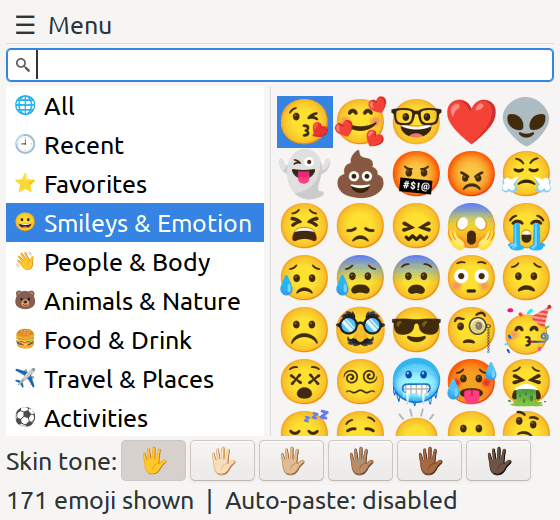
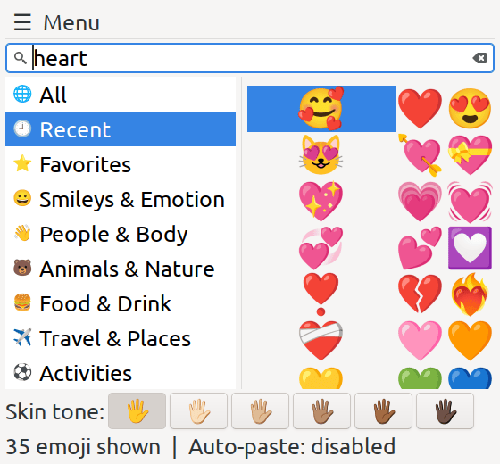

# 🎭 Smorfia

[](LICENSE)


[](https://github.com/FranzBias/Smorfia/releases/latest)
[](https://www.paypal.com/donate/?hosted_button_id=HUF5MYDG465RY)


> **Smorfia was formerly called GeppEmoji.** Same app, new name: from version 2.0.0 on, *GeppEmoji* is *Smorfia*.

**🌍 Languages:**
[English](#english) ·
[Italiano](#italiano) ·
[Deutsch](#deutsch) ·
[Español](#espanol) ·
[Français](#francais) ·
[Nederlands](#nederlands) ·
[Русский](#russkiy) ·
[العربية](#arabiya) ·
[中文](#zhongwen) ·
[日本語](#nihongo)

<p align="center">
  
  
</p>

---

<a id="english"></a>
## 🇬🇧 English

**Smorfia** (formerly **GeppEmoji**) is a small **desktop emoji picker for Linux**, written in Python + GTK 3. Open it with a keyboard shortcut, pick one or more emoji, and it **pastes them straight into the window you were typing in**.

*Why "Smorfia"?* In Italian a *smorfia* is a facial expression, a grimace, and every emoji is a tiny one. In Naples, *la Smorfia* is also the old book that turns dreams into numbers: here, your words turn into faces. 🙂

### ✨ What's new in 2.0.0
- New name: **GeppEmoji → Smorfia** (your data is migrated automatically).
- **Categories in a sidebar** on the left, each with an icon and its name, instead of a drop-down menu.
- **Tooltips show your own tags** next to the English keywords.
- Fixes: empty grid on fresh installs, database update with the `.deb`, skin tone only on "People & Body".
- Full list in the [CHANGELOG](CHANGELOG.md).

### 🔍 Features
- **Search** by name, English keywords, keywords in your language and **your own tags**; typing searches across all categories.
- **Sidebar**: All, Recent, Favorites and every Unicode group, with icons.
- **Custom tags** per language: middle click or `Shift + T` on an emoji.
- **Multi-emoji buffer**: collect several emoji and paste them in one go.
- **Auto-paste** into the previous window (X11 + `xdotool`), or clipboard only.
- **Skin tones** applied only where they make sense.
- **Preferences**: theme, columns, emoji size, interface language, backup and restore of your data.
- **Database update** from the official Unicode `emoji-test.txt`, without restarting.

### 📦 Installation
System packages (Debian / Ubuntu / Mint / LMDE):
```bash
sudo apt install python3-gi python3-gi-cairo gir1.2-gtk-3.0 xdotool
```
**Option 1 – `.deb` package** (from the [Releases](https://github.com/FranzBias/Smorfia/releases/latest) page):
```bash
sudo apt install ./smorfia_2.0.0-1_all.deb
smorfia
```
**Option 2 – user install, no root:**
```bash
git clone https://github.com/FranzBias/Smorfia.git
cd Smorfia
./install_smorfia.sh
```
**Option 3 – run from source:**
```bash
python3 smorfia.py
```
Then bind `smorfia` (or the command printed by the installer) to a global keyboard shortcut.

### ⌨️ Shortcuts
| Action | Keys |
|---|---|
| Insert, paste and close | `Enter` · left click |
| Add to buffer without closing | `Shift + Enter` · `Shift` + left click · right click |
| Edit custom tags | middle click · `Shift + T` |
| Toggle favorite | `Ctrl + F` |
| Go to search / Recent / Favorites | `Ctrl + Alt + F` / `R` / `S` |
| Toggle auto-paste | `Ctrl + Alt + P` |
| Close | `Esc` |

### 🗂️ Your data
Everything personal lives in `~/.config/Smorfia` (settings, recents, favorites, custom tags, emoji database). Coming from GeppEmoji? On first start Smorfia **copies** `~/.config/GeppEmoji` there and leaves the original untouched.

### 🤝 Contributing
- Bugs and ideas: open an [Issue](https://github.com/FranzBias/Smorfia/issues) with your desktop environment, Python version and terminal output.
- New keywords: a Pull Request on `emoji_translations.json`.
- New interface language: copy a file in `locales/`, translate the values (keep the keys) and send a Pull Request.

### ☕ Support
If Smorfia makes your typing a little more expressive, you can [offer a coffee](https://www.paypal.com/donate/?hosted_button_id=HUF5MYDG465RY) or leave a ⭐ on the repository.

### 💙 Credits
- Emoji data: [Unicode `emoji-test.txt`](https://unicode.org/Public/emoji/latest/emoji-test.txt) (Unicode License).
- Inspired by [Smile](https://github.com/mijorus/smile) and [Emote](https://github.com/tom-james-watson/Emote).
- Made by Francesco (FranzBias), with the help of his AI companions.

License: [MIT](LICENSE).

---

<a id="italiano"></a>
## 🇮🇹 Italiano

**Smorfia** (prima si chiamava **GeppEmoji**) è un piccolo **selettore di emoji per il desktop Linux**, scritto in Python + GTK 3. Lo apri con una scorciatoia da tastiera, scegli una o più emoji e lui **le incolla direttamente nella finestra in cui stavi scrivendo**.

*Perché «Smorfia»?* Una smorfia è un'espressione del viso, e ogni emoji ne è una in miniatura. E a Napoli *la Smorfia* è il libro antico che trasforma i sogni in numeri: qui le tue parole diventano faccine. 🙂

### ✨ Novità della 2.0.0
- Nuovo nome: **GeppEmoji → Smorfia** (i tuoi dati vengono trasferiti da soli).
- **Categorie in una colonna a sinistra**, ognuna con icona e nome, al posto del menu a tendina.
- **I tooltip mostrano i tuoi tag** accanto alle parole chiave inglesi.
- Correzioni: griglia vuota alla prima installazione, aggiornamento del database col `.deb`, tono della pelle solo su «Persone e corpo».
- Elenco completo nel [CHANGELOG](CHANGELOG.md).

### 🔍 Funzioni
- **Ricerca** per nome, parole chiave inglesi, parole chiave nella tua lingua e **tag tuoi**; scrivendo si cerca in tutte le categorie.
- **Colonna laterale**: Tutte, Recenti, Preferite e tutti i gruppi Unicode, con le icone.
- **Tag personali** per lingua: click centrale o `Shift + T` su un'emoji.
- **Buffer multi-emoji**: raccogli più emoji e incollale tutte insieme.
- **Incolla automatico** nella finestra precedente (X11 + `xdotool`), oppure solo appunti.
- **Toni della pelle** applicati solo dove hanno senso.
- **Preferenze**: tema, colonne, dimensione emoji, lingua dell'interfaccia, backup e ripristino dei dati.
- **Aggiornamento del database** dal file ufficiale Unicode `emoji-test.txt`, senza riavviare.

### 📦 Installazione
Pacchetti di sistema (Debian / Ubuntu / Mint / LMDE):
```bash
sudo apt install python3-gi python3-gi-cairo gir1.2-gtk-3.0 xdotool
```
**Opzione 1 – pacchetto `.deb`** (dalla pagina [Releases](https://github.com/FranzBias/Smorfia/releases/latest)):
```bash
sudo apt install ./smorfia_2.0.0-1_all.deb
smorfia
```
**Opzione 2 – installazione utente, senza root:**
```bash
git clone https://github.com/FranzBias/Smorfia.git
cd Smorfia
./install_smorfia.sh
```
**Opzione 3 – avvio dai sorgenti:**
```bash
python3 smorfia.py
```
Poi assegna `smorfia` (o il comando mostrato dall'installer) a una scorciatoia da tastiera globale.

### ⌨️ Scorciatoie
| Azione | Tasti |
|---|---|
| Inserisci, incolla e chiudi | `Invio` · click sinistro |
| Aggiungi al buffer senza chiudere | `Shift + Invio` · `Shift` + click sinistro · click destro |
| Modifica i tag personali | click centrale · `Shift + T` |
| Preferito sì/no | `Ctrl + F` |
| Vai a ricerca / Recenti / Preferite | `Ctrl + Alt + F` / `R` / `S` |
| Incolla automatico sì/no | `Ctrl + Alt + P` |
| Chiudi | `Esc` |

### 🗂️ I tuoi dati
Tutto ciò che è personale sta in `~/.config/Smorfia` (impostazioni, recenti, preferiti, tag, database emoji). Arrivi da GeppEmoji? Al primo avvio Smorfia **copia** lì `~/.config/GeppEmoji` e lascia intatto l'originale.

### 🤝 Contribuire
- Bug e idee: apri una [Issue](https://github.com/FranzBias/Smorfia/issues) indicando desktop, versione di Python e output del terminale.
- Nuove parole chiave: una Pull Request su `emoji_translations.json`.
- Nuova lingua dell'interfaccia: copia un file in `locales/`, traduci i valori (le chiavi restano uguali) e manda una Pull Request.

### ☕ Sostegno
Se Smorfia rende la tua scrittura un po' più espressiva, puoi [offrire un caffè](https://www.paypal.com/donate/?hosted_button_id=HUF5MYDG465RY) o lasciare una ⭐ al repository.

### 💙 Riconoscimenti
- Dati delle emoji: [Unicode `emoji-test.txt`](https://unicode.org/Public/emoji/latest/emoji-test.txt) (Licenza Unicode).
- Ispirato da [Smile](https://github.com/mijorus/smile) ed [Emote](https://github.com/tom-james-watson/Emote).
- Creato da Francesco (FranzBias), con l'aiuto dei suoi compagni IA.

Licenza: [MIT](LICENSE).

---

<a id="deutsch"></a>
## 🇩🇪 Deutsch

**Smorfia** (früher **GeppEmoji**) ist eine kleine **Emoji-Auswahl für den Linux-Desktop**, geschrieben in Python + GTK 3. Per Tastenkürzel öffnen, ein oder mehrere Emojis wählen – und sie werden **direkt in das Fenster eingefügt, in dem du gerade geschrieben hast**.

*Warum „Smorfia“?* Auf Italienisch ist eine *smorfia* eine Grimasse, ein Gesichtsausdruck – und jedes Emoji ist eine winzige davon. In Neapel ist *la Smorfia* außerdem das alte Buch, das Träume in Zahlen übersetzt: Hier werden deine Worte zu Gesichtern. 🙂

### ✨ Neu in 2.0.0
- Neuer Name: **GeppEmoji → Smorfia** (deine Daten werden automatisch übernommen).
- **Kategorien in einer Seitenleiste** links, jede mit Symbol und Namen, statt eines Dropdown-Menüs.
- **Tooltips zeigen deine eigenen Tags** neben den englischen Schlüsselwörtern.
- Fehlerbehebungen: leeres Raster bei Neuinstallation, Datenbank-Update mit dem `.deb`, Hautton nur bei „Menschen & Körper“.
- Vollständige Liste im [CHANGELOG](CHANGELOG.md).

### 🔍 Funktionen
- **Suche** nach Name, englischen Schlüsselwörtern, Schlüsselwörtern in deiner Sprache und **eigenen Tags**; beim Tippen wird in allen Kategorien gesucht.
- **Seitenleiste**: Alle, Zuletzt, Favoriten und alle Unicode-Gruppen, mit Symbolen.
- **Eigene Tags** pro Sprache: Mittelklick oder `Shift + T` auf ein Emoji.
- **Mehrfach-Puffer**: mehrere Emojis sammeln und auf einmal einfügen.
- **Automatisches Einfügen** ins vorherige Fenster (X11 + `xdotool`) oder nur Zwischenablage.
- **Hauttöne** nur dort, wo sie sinnvoll sind.
- **Einstellungen**: Design, Spalten, Emoji-Größe, Sprache der Oberfläche, Sicherung und Wiederherstellung.
- **Datenbank-Update** aus der offiziellen Unicode-Datei `emoji-test.txt`, ohne Neustart.

### 📦 Installation
Systempakete (Debian / Ubuntu / Mint / LMDE):
```bash
sudo apt install python3-gi python3-gi-cairo gir1.2-gtk-3.0 xdotool
```
**Option 1 – `.deb`-Paket** (von der Seite [Releases](https://github.com/FranzBias/Smorfia/releases/latest)):
```bash
sudo apt install ./smorfia_2.0.0-1_all.deb
smorfia
```
**Option 2 – Benutzerinstallation, ohne root:**
```bash
git clone https://github.com/FranzBias/Smorfia.git
cd Smorfia
./install_smorfia.sh
```
**Option 3 – direkt aus dem Quellcode:**
```bash
python3 smorfia.py
```
Danach `smorfia` (oder den vom Installer angezeigten Befehl) auf ein globales Tastenkürzel legen.

### ⌨️ Tastenkürzel
| Aktion | Tasten |
|---|---|
| Einfügen und schließen | `Enter` · Linksklick |
| Zum Puffer hinzufügen, ohne zu schließen | `Shift + Enter` · `Shift` + Linksklick · Rechtsklick |
| Eigene Tags bearbeiten | Mittelklick · `Shift + T` |
| Favorit an/aus | `Strg + F` |
| Zur Suche / Zuletzt / Favoriten | `Strg + Alt + F` / `R` / `S` |
| Automatisches Einfügen an/aus | `Strg + Alt + P` |
| Schließen | `Esc` |

### 🗂️ Deine Daten
Alles Persönliche liegt in `~/.config/Smorfia` (Einstellungen, Zuletzt, Favoriten, Tags, Emoji-Datenbank). Du kommst von GeppEmoji? Beim ersten Start **kopiert** Smorfia `~/.config/GeppEmoji` dorthin und lässt das Original unverändert.

### 🤝 Mitmachen
- Fehler und Ideen: ein [Issue](https://github.com/FranzBias/Smorfia/issues) mit Desktop-Umgebung, Python-Version und Terminalausgabe.
- Neue Schlüsselwörter: ein Pull Request für `emoji_translations.json`.
- Neue Sprache der Oberfläche: eine Datei in `locales/` kopieren, die Werte übersetzen (Schlüssel bleiben gleich) und einen Pull Request senden.

### ☕ Unterstützung
Wenn Smorfia dein Schreiben etwas ausdrucksstärker macht, kannst du [einen Kaffee spendieren](https://www.paypal.com/donate/?hosted_button_id=HUF5MYDG465RY) oder dem Repository einen ⭐ geben.

### 💙 Danksagungen
- Emoji-Daten: [Unicode `emoji-test.txt`](https://unicode.org/Public/emoji/latest/emoji-test.txt) (Unicode-Lizenz).
- Inspiriert von [Smile](https://github.com/mijorus/smile) und [Emote](https://github.com/tom-james-watson/Emote).
- Erstellt von Francesco (FranzBias), mit Hilfe seiner KI-Begleiter.

Lizenz: [MIT](LICENSE).

---

<a id="espanol"></a>
## 🇪🇸 Español

**Smorfia** (antes llamado **GeppEmoji**) es un pequeño **selector de emojis para el escritorio Linux**, escrito en Python + GTK 3. Ábrelo con un atajo de teclado, elige uno o varios emojis y **los pega directamente en la ventana en la que estabas escribiendo**.

*¿Por qué «Smorfia»?* En italiano una *smorfia* es una mueca, un gesto de la cara, y cada emoji es una en miniatura. En Nápoles, *la Smorfia* es además el antiguo libro que convierte los sueños en números: aquí tus palabras se convierten en caras. 🙂

### ✨ Novedades de la 2.0.0
- Nuevo nombre: **GeppEmoji → Smorfia** (tus datos se migran automáticamente).
- **Categorías en una barra lateral** a la izquierda, cada una con icono y nombre, en lugar de un menú desplegable.
- **Los tooltips muestran tus propias etiquetas** junto a las palabras clave en inglés.
- Correcciones: cuadrícula vacía en instalaciones nuevas, actualización de la base de datos con el `.deb`, tono de piel solo en «Personas y cuerpo».
- Lista completa en el [CHANGELOG](CHANGELOG.md).

### 🔍 Funciones
- **Búsqueda** por nombre, palabras clave en inglés, palabras clave en tu idioma y **tus etiquetas**; al escribir se busca en todas las categorías.
- **Barra lateral**: Todos, Recientes, Favoritos y todos los grupos Unicode, con iconos.
- **Etiquetas propias** por idioma: clic central o `Shift + T` sobre un emoji.
- **Búfer de varios emojis**: reúne varios y pégalos de una vez.
- **Pegado automático** en la ventana anterior (X11 + `xdotool`), o solo portapapeles.
- **Tonos de piel** aplicados solo donde tienen sentido.
- **Preferencias**: tema, columnas, tamaño de los emojis, idioma de la interfaz, copia de seguridad y restauración.
- **Actualización de la base de datos** desde el archivo oficial Unicode `emoji-test.txt`, sin reiniciar.

### 📦 Instalación
Paquetes del sistema (Debian / Ubuntu / Mint / LMDE):
```bash
sudo apt install python3-gi python3-gi-cairo gir1.2-gtk-3.0 xdotool
```
**Opción 1 – paquete `.deb`** (desde la página [Releases](https://github.com/FranzBias/Smorfia/releases/latest)):
```bash
sudo apt install ./smorfia_2.0.0-1_all.deb
smorfia
```
**Opción 2 – instalación de usuario, sin root:**
```bash
git clone https://github.com/FranzBias/Smorfia.git
cd Smorfia
./install_smorfia.sh
```
**Opción 3 – ejecutar desde el código fuente:**
```bash
python3 smorfia.py
```
Después asigna `smorfia` (o el comando que muestra el instalador) a un atajo de teclado global.

### ⌨️ Atajos
| Acción | Teclas |
|---|---|
| Insertar, pegar y cerrar | `Intro` · clic izquierdo |
| Añadir al búfer sin cerrar | `Shift + Intro` · `Shift` + clic izquierdo · clic derecho |
| Editar etiquetas propias | clic central · `Shift + T` |
| Favorito sí/no | `Ctrl + F` |
| Ir a búsqueda / Recientes / Favoritos | `Ctrl + Alt + F` / `R` / `S` |
| Pegado automático sí/no | `Ctrl + Alt + P` |
| Cerrar | `Esc` |

### 🗂️ Tus datos
Todo lo personal está en `~/.config/Smorfia` (ajustes, recientes, favoritos, etiquetas, base de datos de emojis). ¿Vienes de GeppEmoji? En el primer inicio Smorfia **copia** allí `~/.config/GeppEmoji` y deja intacto el original.

### 🤝 Contribuir
- Errores e ideas: abre un [Issue](https://github.com/FranzBias/Smorfia/issues) con tu entorno de escritorio, versión de Python y salida del terminal.
- Nuevas palabras clave: un Pull Request sobre `emoji_translations.json`.
- Nuevo idioma de la interfaz: copia un archivo de `locales/`, traduce los valores (las claves no cambian) y envía un Pull Request.

### ☕ Apoyo
Si Smorfia hace tu escritura un poco más expresiva, puedes [invitar a un café](https://www.paypal.com/donate/?hosted_button_id=HUF5MYDG465RY) o dejar una ⭐ en el repositorio.

### 💙 Créditos
- Datos de emojis: [Unicode `emoji-test.txt`](https://unicode.org/Public/emoji/latest/emoji-test.txt) (Licencia Unicode).
- Inspirado en [Smile](https://github.com/mijorus/smile) y [Emote](https://github.com/tom-james-watson/Emote).
- Creado por Francesco (FranzBias), con la ayuda de sus compañeros de IA.

Licencia: [MIT](LICENSE).

---

<a id="francais"></a>
## 🇫🇷 Français

**Smorfia** (anciennement **GeppEmoji**) est un petit **sélecteur d'émojis pour le bureau Linux**, écrit en Python + GTK 3. Ouvrez-le avec un raccourci clavier, choisissez un ou plusieurs émojis, et il **les colle directement dans la fenêtre où vous écriviez**.

*Pourquoi « Smorfia » ?* En italien, une *smorfia* est une grimace, une expression du visage, et chaque émoji en est une en miniature. À Naples, *la Smorfia* est aussi le vieux livre qui transforme les rêves en nombres : ici, vos mots deviennent des visages. 🙂

### ✨ Nouveautés de la 2.0.0
- Nouveau nom : **GeppEmoji → Smorfia** (vos données sont migrées automatiquement).
- **Catégories dans une barre latérale** à gauche, chacune avec son icône et son nom, au lieu d'un menu déroulant.
- **Les info-bulles affichent vos propres étiquettes** à côté des mots-clés anglais.
- Corrections : grille vide après une nouvelle installation, mise à jour de la base avec le `.deb`, teint de peau seulement pour « Personnes et corps ».
- Liste complète dans le [CHANGELOG](CHANGELOG.md).

### 🔍 Fonctionnalités
- **Recherche** par nom, mots-clés anglais, mots-clés dans votre langue et **vos étiquettes** ; la saisie cherche dans toutes les catégories.
- **Barre latérale** : Tous, Récents, Favoris et tous les groupes Unicode, avec icônes.
- **Étiquettes personnelles** par langue : clic du milieu ou `Maj + T` sur un émoji.
- **Tampon multi-émojis** : rassemblez-en plusieurs et collez-les d'un coup.
- **Collage automatique** dans la fenêtre précédente (X11 + `xdotool`), ou presse-papiers seul.
- **Teints de peau** appliqués seulement là où ils ont du sens.
- **Préférences** : thème, colonnes, taille des émojis, langue de l'interface, sauvegarde et restauration.
- **Mise à jour de la base** depuis le fichier officiel Unicode `emoji-test.txt`, sans redémarrer.

### 📦 Installation
Paquets système (Debian / Ubuntu / Mint / LMDE) :
```bash
sudo apt install python3-gi python3-gi-cairo gir1.2-gtk-3.0 xdotool
```
**Option 1 – paquet `.deb`** (depuis la page [Releases](https://github.com/FranzBias/Smorfia/releases/latest)) :
```bash
sudo apt install ./smorfia_2.0.0-1_all.deb
smorfia
```
**Option 2 – installation utilisateur, sans root :**
```bash
git clone https://github.com/FranzBias/Smorfia.git
cd Smorfia
./install_smorfia.sh
```
**Option 3 – lancer depuis les sources :**
```bash
python3 smorfia.py
```
Associez ensuite `smorfia` (ou la commande affichée par l'installateur) à un raccourci clavier global.

### ⌨️ Raccourcis
| Action | Touches |
|---|---|
| Insérer, coller et fermer | `Entrée` · clic gauche |
| Ajouter au tampon sans fermer | `Maj + Entrée` · `Maj` + clic gauche · clic droit |
| Modifier les étiquettes | clic du milieu · `Maj + T` |
| Favori oui/non | `Ctrl + F` |
| Aller à la recherche / Récents / Favoris | `Ctrl + Alt + F` / `R` / `S` |
| Collage automatique oui/non | `Ctrl + Alt + P` |
| Fermer | `Échap` |

### 🗂️ Vos données
Tout ce qui est personnel se trouve dans `~/.config/Smorfia` (réglages, récents, favoris, étiquettes, base d'émojis). Vous venez de GeppEmoji ? Au premier lancement, Smorfia y **copie** `~/.config/GeppEmoji` et laisse l'original intact.

### 🤝 Contribuer
- Bugs et idées : ouvrez une [Issue](https://github.com/FranzBias/Smorfia/issues) avec votre environnement de bureau, la version de Python et la sortie du terminal.
- Nouveaux mots-clés : une Pull Request sur `emoji_translations.json`.
- Nouvelle langue d'interface : copiez un fichier de `locales/`, traduisez les valeurs (les clés ne changent pas) et envoyez une Pull Request.

### ☕ Soutien
Si Smorfia rend votre écriture un peu plus expressive, vous pouvez [offrir un café](https://www.paypal.com/donate/?hosted_button_id=HUF5MYDG465RY) ou laisser une ⭐ au dépôt.

### 💙 Remerciements
- Données des émojis : [Unicode `emoji-test.txt`](https://unicode.org/Public/emoji/latest/emoji-test.txt) (Licence Unicode).
- Inspiré par [Smile](https://github.com/mijorus/smile) et [Emote](https://github.com/tom-james-watson/Emote).
- Créé par Francesco (FranzBias), avec l'aide de ses compagnons IA.

Licence : [MIT](LICENSE).

---

<a id="nederlands"></a>
## 🇳🇱 Nederlands

**Smorfia** (vroeger **GeppEmoji**) is een kleine **emoji-kiezer voor de Linux-desktop**, geschreven in Python + GTK 3. Open hem met een sneltoets, kies een of meer emoji's en hij **plakt ze direct in het venster waarin je aan het typen was**.

*Waarom "Smorfia"?* In het Italiaans is een *smorfia* een grimas, een gezichtsuitdrukking, en elke emoji is er een in het klein. In Napels is *la Smorfia* bovendien het oude boek dat dromen in getallen omzet: hier worden jouw woorden gezichtjes. 🙂

### ✨ Nieuw in 2.0.0
- Nieuwe naam: **GeppEmoji → Smorfia** (je gegevens worden automatisch overgezet).
- **Categorieën in een zijbalk** links, elk met pictogram en naam, in plaats van een uitklapmenu.
- **Tooltips tonen je eigen tags** naast de Engelse trefwoorden.
- Oplossingen: lege raster bij een nieuwe installatie, database-update met de `.deb`, huidskleur alleen bij "Mensen en lichaam".
- Volledige lijst in de [CHANGELOG](CHANGELOG.md).

### 🔍 Functies
- **Zoeken** op naam, Engelse trefwoorden, trefwoorden in jouw taal en **je eigen tags**; tijdens het typen wordt in alle categorieën gezocht.
- **Zijbalk**: Alle, Recent, Favorieten en alle Unicode-groepen, met pictogrammen.
- **Eigen tags** per taal: middelklik of `Shift + T` op een emoji.
- **Buffer voor meerdere emoji's**: verzamel er een paar en plak ze in één keer.
- **Automatisch plakken** in het vorige venster (X11 + `xdotool`), of alleen klembord.
- **Huidskleuren** alleen waar ze zinvol zijn.
- **Voorkeuren**: thema, kolommen, emoji-grootte, taal van de interface, back-up en herstel.
- **Database bijwerken** vanuit het officiële Unicode-bestand `emoji-test.txt`, zonder herstart.

### 📦 Installatie
Systeempakketten (Debian / Ubuntu / Mint / LMDE):
```bash
sudo apt install python3-gi python3-gi-cairo gir1.2-gtk-3.0 xdotool
```
**Optie 1 – `.deb`-pakket** (van de pagina [Releases](https://github.com/FranzBias/Smorfia/releases/latest)):
```bash
sudo apt install ./smorfia_2.0.0-1_all.deb
smorfia
```
**Optie 2 – gebruikersinstallatie, zonder root:**
```bash
git clone https://github.com/FranzBias/Smorfia.git
cd Smorfia
./install_smorfia.sh
```
**Optie 3 – direct vanuit de broncode:**
```bash
python3 smorfia.py
```
Koppel daarna `smorfia` (of de opdracht die het installatieprogramma toont) aan een globale sneltoets.

### ⌨️ Sneltoetsen
| Actie | Toetsen |
|---|---|
| Invoegen, plakken en sluiten | `Enter` · linksklik |
| Aan buffer toevoegen zonder sluiten | `Shift + Enter` · `Shift` + linksklik · rechtsklik |
| Eigen tags bewerken | middelklik · `Shift + T` |
| Favoriet aan/uit | `Ctrl + F` |
| Naar zoeken / Recent / Favorieten | `Ctrl + Alt + F` / `R` / `S` |
| Automatisch plakken aan/uit | `Ctrl + Alt + P` |
| Sluiten | `Esc` |

### 🗂️ Je gegevens
Alles wat persoonlijk is staat in `~/.config/Smorfia` (instellingen, recent, favorieten, tags, emoji-database). Kom je van GeppEmoji? Bij de eerste start **kopieert** Smorfia `~/.config/GeppEmoji` daarheen en laat het origineel ongemoeid.

### 🤝 Bijdragen
- Bugs en ideeën: open een [Issue](https://github.com/FranzBias/Smorfia/issues) met je desktopomgeving, Python-versie en terminaluitvoer.
- Nieuwe trefwoorden: een Pull Request op `emoji_translations.json`.
- Nieuwe interfacetaal: kopieer een bestand uit `locales/`, vertaal de waarden (de sleutels blijven gelijk) en stuur een Pull Request.

### ☕ Steun
Maakt Smorfia je schrijven wat expressiever? Je kunt [een koffie trakteren](https://www.paypal.com/donate/?hosted_button_id=HUF5MYDG465RY) of een ⭐ achterlaten op de repository.

### 💙 Dankwoord
- Emoji-gegevens: [Unicode `emoji-test.txt`](https://unicode.org/Public/emoji/latest/emoji-test.txt) (Unicode-licentie).
- Geïnspireerd door [Smile](https://github.com/mijorus/smile) en [Emote](https://github.com/tom-james-watson/Emote).
- Gemaakt door Francesco (FranzBias), met hulp van zijn AI-metgezellen.

Licentie: [MIT](LICENSE).

---

<a id="russkiy"></a>
## 🇷🇺 Русский

**Smorfia** (раньше называлась **GeppEmoji**) — небольшая **программа выбора эмодзи для рабочего стола Linux**, написанная на Python + GTK 3. Откройте её сочетанием клавиш, выберите один или несколько эмодзи — и она **вставит их прямо в окно, в котором вы печатали**.

*Почему «Smorfia»?* По-итальянски *smorfia* — это гримаса, выражение лица, а каждый эмодзи — гримаса в миниатюре. В Неаполе *la Smorfia* — ещё и старинная книга, превращающая сны в числа: здесь ваши слова превращаются в лица. 🙂

### ✨ Что нового в 2.0.0
- Новое имя: **GeppEmoji → Smorfia** (ваши данные переносятся автоматически).
- **Категории в боковой панели** слева, у каждой значок и название, вместо выпадающего меню.
- **Всплывающие подсказки показывают ваши собственные теги** рядом с английскими ключевыми словами.
- Исправления: пустая сетка при новой установке, обновление базы при установке из `.deb`, тон кожи только для «Люди и тело».
- Полный список — в [CHANGELOG](CHANGELOG.md).

### 🔍 Возможности
- **Поиск** по названию, английским ключевым словам, ключевым словам на вашем языке и **вашим тегам**; при вводе поиск идёт по всем категориям.
- **Боковая панель**: Все, Недавние, Избранное и все группы Unicode, со значками.
- **Собственные теги** для каждого языка: средний клик или `Shift + T` на эмодзи.
- **Буфер для нескольких эмодзи**: соберите несколько и вставьте разом.
- **Автовставка** в предыдущее окно (X11 + `xdotool`) или только буфер обмена.
- **Тоны кожи** применяются только там, где это имеет смысл.
- **Настройки**: тема, число столбцов, размер эмодзи, язык интерфейса, резервное копирование и восстановление.
- **Обновление базы** из официального файла Unicode `emoji-test.txt` без перезапуска.

### 📦 Установка
Системные пакеты (Debian / Ubuntu / Mint / LMDE):
```bash
sudo apt install python3-gi python3-gi-cairo gir1.2-gtk-3.0 xdotool
```
**Вариант 1 – пакет `.deb`** (со страницы [Releases](https://github.com/FranzBias/Smorfia/releases/latest)):
```bash
sudo apt install ./smorfia_2.0.0-1_all.deb
smorfia
```
**Вариант 2 – установка для пользователя, без root:**
```bash
git clone https://github.com/FranzBias/Smorfia.git
cd Smorfia
./install_smorfia.sh
```
**Вариант 3 – запуск из исходников:**
```bash
python3 smorfia.py
```
Затем назначьте `smorfia` (или команду, которую выводит установщик) глобальному сочетанию клавиш.

### ⌨️ Сочетания клавиш
| Действие | Клавиши |
|---|---|
| Вставить и закрыть | `Enter` · левый клик |
| Добавить в буфер, не закрывая | `Shift + Enter` · `Shift` + левый клик · правый клик |
| Редактировать свои теги | средний клик · `Shift + T` |
| Избранное вкл./выкл. | `Ctrl + F` |
| К поиску / Недавним / Избранному | `Ctrl + Alt + F` / `R` / `S` |
| Автовставка вкл./выкл. | `Ctrl + Alt + P` |
| Закрыть | `Esc` |

### 🗂️ Ваши данные
Всё личное хранится в `~/.config/Smorfia` (настройки, недавние, избранное, теги, база эмодзи). Переходите с GeppEmoji? При первом запуске Smorfia **копирует** туда `~/.config/GeppEmoji`, не трогая оригинал.

### 🤝 Участие
- Ошибки и идеи: откройте [Issue](https://github.com/FranzBias/Smorfia/issues), указав окружение рабочего стола, версию Python и вывод терминала.
- Новые ключевые слова: Pull Request с изменениями в `emoji_translations.json`.
- Новый язык интерфейса: скопируйте файл из `locales/`, переведите значения (ключи не меняются) и отправьте Pull Request.

### ☕ Поддержка
Если Smorfia делает ваши тексты чуть выразительнее, можно [угостить кофе](https://www.paypal.com/donate/?hosted_button_id=HUF5MYDG465RY) или поставить ⭐ репозиторию.

### 💙 Благодарности
- Данные эмодзи: [Unicode `emoji-test.txt`](https://unicode.org/Public/emoji/latest/emoji-test.txt) (лицензия Unicode).
- Вдохновлено [Smile](https://github.com/mijorus/smile) и [Emote](https://github.com/tom-james-watson/Emote).
- Создано Франческо (FranzBias) при помощи его ИИ-компаньонов.

Лицензия: [MIT](LICENSE).

---

<a id="arabiya"></a>
## 🇸🇦 العربية

<div dir="rtl">

**Smorfia** (كان اسمه سابقًا **GeppEmoji**) أداة صغيرة **لاختيار الرموز التعبيرية على سطح مكتب لينكس**، مكتوبة بلغة Python مع GTK 3. افتحها باختصار من لوحة المفاتيح، واختر رمزًا تعبيريًا أو أكثر، فتقوم **بلصقها مباشرة في النافذة التي كنت تكتب فيها**.

*لماذا «Smorfia»؟* كلمة *smorfia* بالإيطالية تعني تعبير الوجه أو التكشيرة، وكل رمز تعبيري هو تكشيرة صغيرة. وفي نابولي، *la Smorfia* هو أيضًا الكتاب القديم الذي يحوّل الأحلام إلى أرقام: وهنا تتحول كلماتك إلى وجوه. 🙂

### ✨ الجديد في الإصدار 2.0.0
- اسم جديد: **GeppEmoji ← Smorfia** (تُنقل بياناتك تلقائيًا).
- **الفئات في شريط جانبي** على اليسار، لكل منها أيقونة واسم، بدلًا من القائمة المنسدلة.
- **تلميحات تعرض وسومك الخاصة** إلى جانب الكلمات المفتاحية الإنجليزية.
- إصلاحات: شبكة فارغة عند التثبيت الجديد، تحديث قاعدة البيانات مع حزمة `.deb`، لون البشرة فقط في فئة «الأشخاص والجسد».
- القائمة الكاملة في [CHANGELOG](CHANGELOG.md).

### 🔍 الميزات
- **البحث** بالاسم، وبالكلمات المفتاحية الإنجليزية، وبكلمات بلغتك، و**بوسومك الخاصة**؛ وعند الكتابة يشمل البحث كل الفئات.
- **شريط جانبي**: الكل، الأخيرة، المفضلة، وكل مجموعات Unicode مع أيقوناتها.
- **وسوم خاصة** لكل لغة: نقرة بالزر الأوسط أو `Shift + T` على الرمز.
- **مخزن مؤقت لعدة رموز**: اجمع عدة رموز والصقها دفعة واحدة.
- **لصق تلقائي** في النافذة السابقة (X11 مع `xdotool`) أو الحافظة فقط.
- **ألوان البشرة** تُطبَّق فقط حيث يكون لها معنى.
- **التفضيلات**: السمة، عدد الأعمدة، حجم الرموز، لغة الواجهة، النسخ الاحتياطي والاستعادة.
- **تحديث قاعدة البيانات** من ملف Unicode الرسمي `emoji-test.txt` دون إعادة تشغيل.

### 📦 التثبيت
حزم النظام (Debian / Ubuntu / Mint / LMDE):

</div>

```bash
sudo apt install python3-gi python3-gi-cairo gir1.2-gtk-3.0 xdotool
```

<div dir="rtl">

**الخيار 1 – حزمة `.deb`** (من صفحة [Releases](https://github.com/FranzBias/Smorfia/releases/latest)):

</div>

```bash
sudo apt install ./smorfia_2.0.0-1_all.deb
smorfia
```

<div dir="rtl">

**الخيار 2 – تثبيت للمستخدم دون صلاحيات root:**

</div>

```bash
git clone https://github.com/FranzBias/Smorfia.git
cd Smorfia
./install_smorfia.sh
```

<div dir="rtl">

**الخيار 3 – التشغيل من الشيفرة المصدرية:**

</div>

```bash
python3 smorfia.py
```

<div dir="rtl">

بعد ذلك اربط الأمر `smorfia` (أو الأمر الذي يعرضه المثبّت) باختصار عام في لوحة المفاتيح.

### ⌨️ الاختصارات

| الإجراء | المفاتيح |
|---|---|
| إدراج ولصق وإغلاق | `Enter` · نقرة يسرى |
| إضافة إلى المخزن دون إغلاق | `Shift + Enter` · `Shift` + نقرة يسرى · نقرة يمنى |
| تحرير الوسوم الخاصة | نقرة وسطى · `Shift + T` |
| تفعيل/إلغاء المفضلة | `Ctrl + F` |
| الانتقال إلى البحث / الأخيرة / المفضلة | `Ctrl + Alt + F` / `R` / `S` |
| تفعيل/إلغاء اللصق التلقائي | `Ctrl + Alt + P` |
| إغلاق | `Esc` |

### 🗂️ بياناتك
كل ما هو شخصي موجود في `~/.config/Smorfia` (الإعدادات، الأخيرة، المفضلة، الوسوم، قاعدة بيانات الرموز). هل تأتي من GeppEmoji؟ عند التشغيل الأول **ينسخ** Smorfia المجلد `~/.config/GeppEmoji` إلى هناك ويترك الأصل دون تغيير.

### 🤝 المساهمة
- الأخطاء والأفكار: افتح [Issue](https://github.com/FranzBias/Smorfia/issues) مع ذكر بيئة سطح المكتب وإصدار Python ومخرجات الطرفية.
- كلمات مفتاحية جديدة: طلب دمج (Pull Request) على `emoji_translations.json`.
- لغة واجهة جديدة: انسخ ملفًا من `locales/` وترجم القيم (تبقى المفاتيح كما هي) ثم أرسل طلب دمج.

### ☕ الدعم
إذا جعل Smorfia كتابتك أكثر تعبيرًا، يمكنك [دعوتي إلى فنجان قهوة](https://www.paypal.com/donate/?hosted_button_id=HUF5MYDG465RY) أو منح المستودع ⭐.

### 💙 شكر وتقدير
- بيانات الرموز: [Unicode `emoji-test.txt`](https://unicode.org/Public/emoji/latest/emoji-test.txt) (رخصة Unicode).
- مستوحى من [Smile](https://github.com/mijorus/smile) و[Emote](https://github.com/tom-james-watson/Emote).
- من صنع فرانشيسكو (FranzBias) بمساعدة رفاقه من الذكاء الاصطناعي.

الرخصة: [MIT](LICENSE).

</div>

---

<a id="zhongwen"></a>
## 🇨🇳 中文

**Smorfia**（原名 **GeppEmoji**）是一款小巧的 **Linux 桌面表情符号选择器**，使用 Python + GTK 3 编写。用快捷键打开它，选择一个或多个表情，它会**直接把表情粘贴到你刚才输入的窗口里**。

*为什么叫 “Smorfia”？* 在意大利语中，*smorfia* 意为鬼脸、面部表情，而每个表情符号都是一个小小的鬼脸。在那不勒斯，*la Smorfia* 还是一本把梦境变成数字的古老书籍：在这里，你的文字变成了表情。🙂

### ✨ 2.0.0 新功能
- 新名称：**GeppEmoji → Smorfia**（你的数据会自动迁移）。
- **分类改为左侧边栏**，每个分类都有图标和名称，取代了下拉菜单。
- **悬停提示显示你自己的标签**，以及英文关键词。
- 修复：全新安装时表情网格为空、使用 `.deb` 时数据库无法更新、肤色只作用于“人物与身体”。
- 完整列表见 [CHANGELOG](CHANGELOG.md)。

### 🔍 功能
- **搜索**：按名称、英文关键词、你的语言的关键词以及**你自己的标签**；输入时会在所有分类中搜索。
- **侧边栏**：全部、最近、收藏以及所有 Unicode 分组，均带图标。
- **自定义标签**（按语言）：在表情上点击鼠标中键或按 `Shift + T`。
- **多表情缓冲区**：收集多个表情后一次性粘贴。
- **自动粘贴**到上一个窗口（X11 + `xdotool`），或仅复制到剪贴板。
- **肤色**只应用于合适的表情。
- **首选项**：主题、列数、表情大小、界面语言、数据备份与恢复。
- **更新数据库**：使用 Unicode 官方文件 `emoji-test.txt`，无需重启。

### 📦 安装
系统软件包（Debian / Ubuntu / Mint / LMDE）：
```bash
sudo apt install python3-gi python3-gi-cairo gir1.2-gtk-3.0 xdotool
```
**方式一 – `.deb` 软件包**（来自 [Releases](https://github.com/FranzBias/Smorfia/releases/latest) 页面）：
```bash
sudo apt install ./smorfia_2.0.0-1_all.deb
smorfia
```
**方式二 – 用户级安装，无需 root：**
```bash
git clone https://github.com/FranzBias/Smorfia.git
cd Smorfia
./install_smorfia.sh
```
**方式三 – 直接从源码运行：**
```bash
python3 smorfia.py
```
然后把 `smorfia`（或安装程序显示的命令）绑定到全局快捷键。

### ⌨️ 快捷键
| 操作 | 按键 |
|---|---|
| 插入、粘贴并关闭 | `Enter` · 左键单击 |
| 加入缓冲区但不关闭 | `Shift + Enter` · `Shift` + 左键 · 右键 |
| 编辑自定义标签 | 中键 · `Shift + T` |
| 收藏/取消收藏 | `Ctrl + F` |
| 跳到搜索 / 最近 / 收藏 | `Ctrl + Alt + F` / `R` / `S` |
| 开关自动粘贴 | `Ctrl + Alt + P` |
| 关闭 | `Esc` |

### 🗂️ 你的数据
所有个人数据都保存在 `~/.config/Smorfia`（设置、最近、收藏、标签、表情数据库）。从 GeppEmoji 升级？首次启动时，Smorfia 会把 `~/.config/GeppEmoji` **复制**过来，原文件夹保持不变。

### 🤝 参与贡献
- 问题与建议：提交 [Issue](https://github.com/FranzBias/Smorfia/issues)，并注明桌面环境、Python 版本和终端输出。
- 新关键词：针对 `emoji_translations.json` 提交 Pull Request。
- 新界面语言：复制 `locales/` 中的一个文件，翻译其中的值（键保持不变），然后提交 Pull Request。

### ☕ 支持
如果 Smorfia 让你的文字更生动，可以[请我喝杯咖啡](https://www.paypal.com/donate/?hosted_button_id=HUF5MYDG465RY)，或给仓库点一个 ⭐。

### 💙 致谢
- 表情数据：[Unicode `emoji-test.txt`](https://unicode.org/Public/emoji/latest/emoji-test.txt)（Unicode 许可证）。
- 灵感来自 [Smile](https://github.com/mijorus/smile) 和 [Emote](https://github.com/tom-james-watson/Emote)。
- 由 Francesco（FranzBias）在他的 AI 伙伴帮助下制作。

许可证：[MIT](LICENSE)。

---

<a id="nihongo"></a>
## 🇯🇵 日本語

**Smorfia**（旧名 **GeppEmoji**）は、Python + GTK 3 で書かれた小さな **Linux デスクトップ用の絵文字ピッカー**です。キーボードショートカットで開き、絵文字を一つまたは複数選ぶと、**直前まで入力していたウィンドウにそのまま貼り付けます**。

*なぜ「Smorfia」？* イタリア語の *smorfia* は「しかめ面・表情」という意味で、絵文字はどれも小さな表情です。ナポリでは *la Smorfia* は夢を数字に変える古い本の名前でもあります。ここでは、あなたの言葉が顔に変わります。🙂

### ✨ 2.0.0 の新機能
- 新しい名前：**GeppEmoji → Smorfia**（データは自動的に移行されます）。
- **カテゴリーを左側のサイドバーに**。ドロップダウンメニューの代わりに、アイコンと名前付きで並びます。
- **ツールチップにあなた自身のタグ**と英語のキーワードを表示。
- 修正：新規インストール時にグリッドが空になる問題、`.deb` でのデータベース更新、肌の色は「人と体」のみに適用。
- 詳しくは [CHANGELOG](CHANGELOG.md) をご覧ください。

### 🔍 機能
- **検索**：名前、英語のキーワード、あなたの言語のキーワード、そして**自分のタグ**で検索。入力すると全カテゴリーから探します。
- **サイドバー**：すべて・最近・お気に入り・すべての Unicode グループ（アイコン付き）。
- **カスタムタグ**（言語ごと）：絵文字の上で中クリック、または `Shift + T`。
- **複数絵文字バッファー**：いくつか集めてまとめて貼り付け。
- **自動貼り付け**：直前のウィンドウへ（X11 + `xdotool`）、またはクリップボードのみ。
- **肌の色**は意味のある絵文字にだけ適用。
- **設定**：テーマ、列数、絵文字のサイズ、表示言語、データのバックアップと復元。
- **データベース更新**：Unicode 公式の `emoji-test.txt` から、再起動なしで。

### 📦 インストール
システムパッケージ（Debian / Ubuntu / Mint / LMDE）：
```bash
sudo apt install python3-gi python3-gi-cairo gir1.2-gtk-3.0 xdotool
```
**方法 1 – `.deb` パッケージ**（[Releases](https://github.com/FranzBias/Smorfia/releases/latest) ページから）：
```bash
sudo apt install ./smorfia_2.0.0-1_all.deb
smorfia
```
**方法 2 – ユーザー単位のインストール（root 不要）：**
```bash
git clone https://github.com/FranzBias/Smorfia.git
cd Smorfia
./install_smorfia.sh
```
**方法 3 – ソースから直接実行：**
```bash
python3 smorfia.py
```
その後、`smorfia`（またはインストーラーが表示するコマンド）をグローバルショートカットに割り当ててください。

### ⌨️ ショートカット
| 操作 | キー |
|---|---|
| 挿入・貼り付けて閉じる | `Enter` · 左クリック |
| 閉じずにバッファーへ追加 | `Shift + Enter` · `Shift` + 左クリック · 右クリック |
| カスタムタグを編集 | 中クリック · `Shift + T` |
| お気に入りの切り替え | `Ctrl + F` |
| 検索 / 最近 / お気に入りへ移動 | `Ctrl + Alt + F` / `R` / `S` |
| 自動貼り付けの切り替え | `Ctrl + Alt + P` |
| 閉じる | `Esc` |

### 🗂️ あなたのデータ
個人的なデータはすべて `~/.config/Smorfia` にあります（設定、最近、お気に入り、タグ、絵文字データベース）。GeppEmoji から移行する場合、初回起動時に Smorfia が `~/.config/GeppEmoji` をそこへ**コピー**し、元のフォルダーはそのまま残します。

### 🤝 コントリビュート
- バグやアイデア：デスクトップ環境、Python のバージョン、ターミナルの出力を添えて [Issue](https://github.com/FranzBias/Smorfia/issues) を作成してください。
- 新しいキーワード：`emoji_translations.json` への Pull Request。
- 新しい表示言語：`locales/` のファイルをコピーして値を翻訳し（キーはそのまま）、Pull Request を送ってください。

### ☕ サポート
Smorfia で文章が少しでも表情豊かになったら、[コーヒーをおごる](https://www.paypal.com/donate/?hosted_button_id=HUF5MYDG465RY)か、リポジトリに ⭐ をお願いします。

### 💙 クレジット
- 絵文字データ：[Unicode `emoji-test.txt`](https://unicode.org/Public/emoji/latest/emoji-test.txt)（Unicode ライセンス）。
- [Smile](https://github.com/mijorus/smile) と [Emote](https://github.com/tom-james-watson/Emote) に触発されました。
- 作者：Francesco（FranzBias）。AI の仲間たちの助けを借りて制作。

ライセンス：[MIT](LICENSE)。
